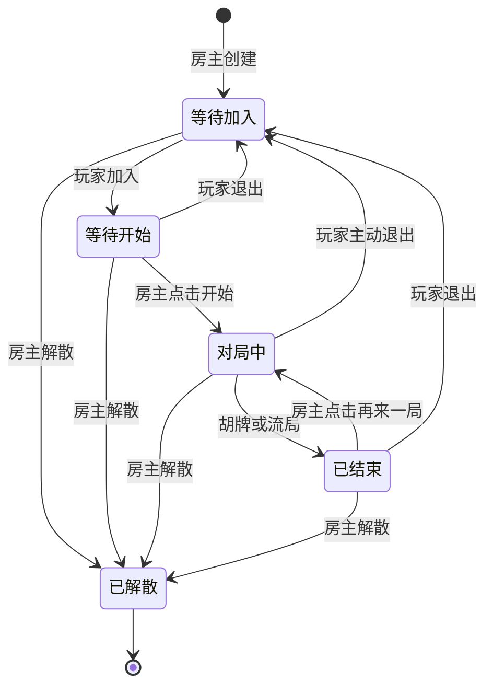

# 手机全屏麻将与房间流程升级设计

日期：2026-09-30  
基准代码与已上线前端：`4d56c628ecbb490fafb6974620c2b39d2e3da8d1`  
生产地址：`https://mj.duanap.cn`  
状态：需求与开局方式已确认；本文供实施前审阅。

## 1. 目标与范围

让游戏占满手机可用屏幕，手牌和操作更醒目；房间创建、等待、开局、结束、重开和退出具有一致流程。保留目前按参考图制作的牌面，以及已上线的“操作按钮在手牌上方”。

本次包含：全屏横向界面、指定背景、房间按钮与管理弹窗、房主开始/重开、移除产品中的准备流程、结算亮牌、所有弹窗关闭方式，以及杠/胡/结算特效。实施完成后验证并更新现有域名。

继续使用原生 TypeScript、esbuild、Socket.IO 和内存房间管理，复用现有规则引擎；不增加登录、数据库、观战、付费服务或新前端框架。沿用筒/条、两杠起胡及现有庄家与胜负统计规则。

## 2. 全屏与背景

- 游戏根容器填满可用视口，去掉最大宽度、外围厚边框及大块外边距。顶栏浮在背景上，手牌位于屏幕底部，操作区始终在手牌上方。
- 继续只做横向界面。竖屏窗口用 CSS 旋转整个游戏，弹窗和特效随同旋转；不请求系统方向或全屏权限，不显示旋转提示。
- 背景原样使用用户提供的 `ChatGPT 图像 2026年9月30日 15_05_06.png`，以 `cover` 居中铺满。保留图片原始内容，不重新生成；采用带内容哈希的资产文件名。
- 原图 SHA256：`fe18606584f11b0807519806bc9e464f3eb0ab7411282ab405ebd6201cef14be`。
- 背景资源独立加载，避免将约 1.39 MB PNG 编入前端脚本；本地与生产静态服务增加正确的 PNG MIME。
- 缩小对手牌背和次要信息占用，优先把空间给手牌与操作。14 张手牌尽量单排完整显示；按实际可用宽度计算尺寸，摸牌留缝、选牌抬起。
- 保留已修正的横向安全区映射，适配刘海、底部手势区域和窗口尺寸改变；不因缩放丢失房间号输入或光标。

验收视口：844×390、667×375、568×320；390×844 窗口内显示横向游戏。要求无横向溢出，操作按钮与手牌不重叠，弹窗可完整操作。

## 3. 房间生命周期

采用真实服务端房间状态，不仅修改弹窗表现：

“等待加入”和“等待开始”属于同一等待状态，按人数显示文案；不设玩家准备按钮或准备标记。

- 创建者固定为房主（座位 0），加入者为玩家（座位 1）。房主身份独立于本局庄家，输赢或连庄不改变管理权限。
- 房主创建后，双方进入等待房间。只有房主点击开始且双方在线，才发牌、定花并启动对局计时。
- 不在房间等待阶段发出私人牌局视图，防止提前查看牌面后反复换房。非房主、人数不足或未在线时，开始请求被服务端拒绝。
- 创建成功自动打开房间弹窗；加入成功也打开。开始或再来一局成功后，双方弹窗自动关闭。
- 游戏进行中点击房间按钮，可以重新查看信息；普通状态同步不自动关闭玩家主动打开的弹窗。
- 断线与主动退出不同：断线保留座位和重连凭据，沿用已有托管与重连能力；主动退出撤销玩家凭据、停止当前未完成对局，让房主回到等待加入，不额外计输赢。
- 玩家主动退出后，房间可让新的玩家加入。旧玩家凭据不能重回已释放座位。
- 房主解散会通知双方、停止房间计时器、移除房间并清理连接的房间会话。客户端清除保存的房间信息，返回人机模式。
- 空房仍保留现有 10 分钟自动回收策略。

## 4. 房间弹窗与权限

顶栏统一使用“房间”按钮。未加入时弹窗提供创建和加入；加入后显示房间号、本人角色、两个成员及在线状态、当前阶段、局数和累计战绩。

| 操作 | 房主 | 玩家 | 条件 |
| --- | --- | --- | --- |
| 查看房间信息 | 可以 | 可以 | 当前会话属于房间 |
| 开始游戏 | 可以 | 不可以 | 等待阶段，双方在线 |
| 再来一局 | 可以 | 不可以 | 已结算，双方在线 |
| 退出房间 | 不显示、不允许 | 可以 | 等待、对局、结算阶段均可 |
| 解散房间 | 可以 | 不显示、不允许 | 所有未解散阶段 |

前端按角色显示按钮，服务端同时检查真实会话、当前绑定连接和角色。客户端伪造座位、使用旧连接或失效凭据，均不能绕过权限。

增加房间信息/更新、开始、玩家退出、房主解散和重开协议。保留现有按玩家视角过滤的对局状态；房间信息不携带重连 token、对手暗牌或牌墙内容。

## 5. 移除准备与再来一局

- 页面和对外房间协议移除准备按钮、准备标记、等待双方准备文案与客户端 ready 操作。
- 结算后不再由超时托管自动进入下一局，结果保持到房主主动重开。
- 房主一次“再来一局”统一推进双方，复用引擎已有下一局规则，不产生两次玩家准备步骤或中间等待界面。
- 保留累计胜负、局数递增、胡牌者下局坐庄、流局连庄等规则。
- 人机模式由本地玩家点击“再来一局”继续，同样不显示准备过程。
- 未结束时拒绝重开；玩家不在线时保留结果并提示等待上线。

## 6. 结束亮牌与统一弹窗关闭

- 胡牌或流局后，在牌桌和结算弹窗展示双方完整手牌与副露；结束后的暗杠也可展示，正常对局中仍保密。
- 结算弹窗展示胜负/流局原因、本局牌面、累计战绩。房主显示“再来一局”，玩家显示等待房主的说明。
- 每个弹窗都提供可触控的关闭按钮，支持点真正的空白遮罩和 Esc 关闭。点弹窗内部、输入框或操作按钮不会误关闭。
- 关闭弹窗只改变界面，不等于退出、解散、重开或发送对局操作。
- 关闭结算弹窗后仍可在牌桌查看亮牌，通过结果入口重新打开；房主仍能重开。
- 房间、加入表单、完整牌河、记录与结算统一采用一个弹窗状态管理，避免多层遮罩、焦点残留和关闭后牌桌仍不可操作。
- 保留键盘焦点约束和输入草稿恢复；网络操作尚在确认中时，关闭弹窗不解除操作锁。

## 7. 杠、胡与结算特效

- 杠：短暂的金色文字、扩散波纹和对应音效；按明杠/暗杠/补杠显示提示，不展示对手暗杠的具体牌面。
- 胡：胡/自摸提示和短暂聚光，随后进入结算；效果先出现，结算弹窗不立即遮掉提示。
- 结算：胜负/流局结果与累计战绩的短过渡效果。关闭结果后结束效果，不自动重开。
- 特效位于独立持久层，按对局事件触发，避免普通重绘或重连快照重复播放。
- 效果不拦截点击、不遮住操作超过短动画时长；静音开关保持有效，减少动态效果偏好下简化动画。

## 8. 实现边界与错误处理

采用现有栈扩展房间控制器、轻量弹窗管理和事件特效层，比整体迁移到新框架更贴合本次需求与现有项目。规则引擎内部既有推进机制复用，产品和房间协议不再暴露准备状态。

- 房间状态与角色由服务端权威管理；UI 展示与权限检查双重一致。
- 房间被解散、玩家退出、房间不存在、人数不足、旧会话、请求超时等情况都有明确可读反馈。
- 使用协议版本标记处理旧页面；旧页面请求新房间流程时给出刷新提示，不创建不可操作的幽灵房间。
- 保留已有手牌副本映射、零号一筒、选牌二次确认、等待响应锁和视角过滤修复。
- 对手暗杠事件同样隐藏牌面，特效和日志不造成泄露。

## 9. 验证与发布

在实现前为房间行为写失败测试，重点覆盖：房主/玩家权限、未开始不能行动、人数不足不能开始、退出后旧 token 失效、旧连接不能管理房间、解散后的会话清理、结算不自动重开、房主重开一次、统计与庄家延续、隐藏暗杠及结束亮牌。

运行完整现有测试与相关新测试，完成引擎/服务端/前端类型检查及构建。浏览器验证手机尺寸、手牌触控、房间创建/加入/开始、关闭遮罩、结算亮牌、重开、退出/解散、刷新重连和特效。使用双客户端验证真实权限，进行独立代码审查。

这次涉及服务端协议更新，发布采用新 release 与现有备份/回滚流程，仅更新 mj.duanap.cn 的应用。先检查旧房间状态，优先在空房时切换；后端升级需要重启独立服务，内存房间不能跨版本保存。若上线时仍有人在对局，报告状态并等待合适的切换时机。

保持现有 Nginx、TLS 和已验证的源站 no-store 策略；不修改其它域名或 EdgeOne 规则。验证源站与公网健康、JS 版本、背景图片和公网 WebSocket。未经进一步要求不推送 GitHub。

## 10. 完成条件

- 全屏横向游戏使用指定背景，手机端空间分配明显优先于次要信息。
- 房间按钮、角色权限、自动开关弹窗、房主开始和重开均实现。
- 产品不再出现准备步骤；结算停止自动推进，双方亮牌。
- 所有弹窗可关闭，关闭不触发房间/对局动作。
- 杠、胡和结算效果存在且不泄露暗牌、不妨碍操作。
- 测试、类型检查、构建与双端/手机验证通过，发布结果与回滚信息准确报告。
